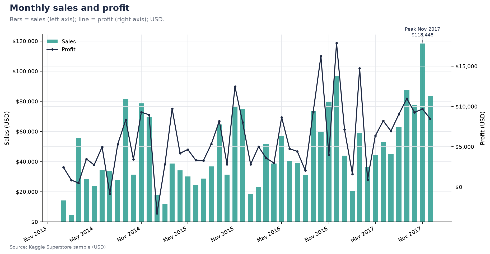
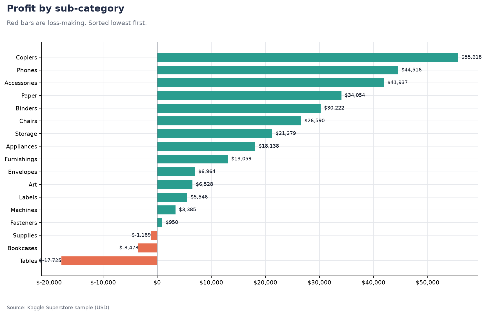
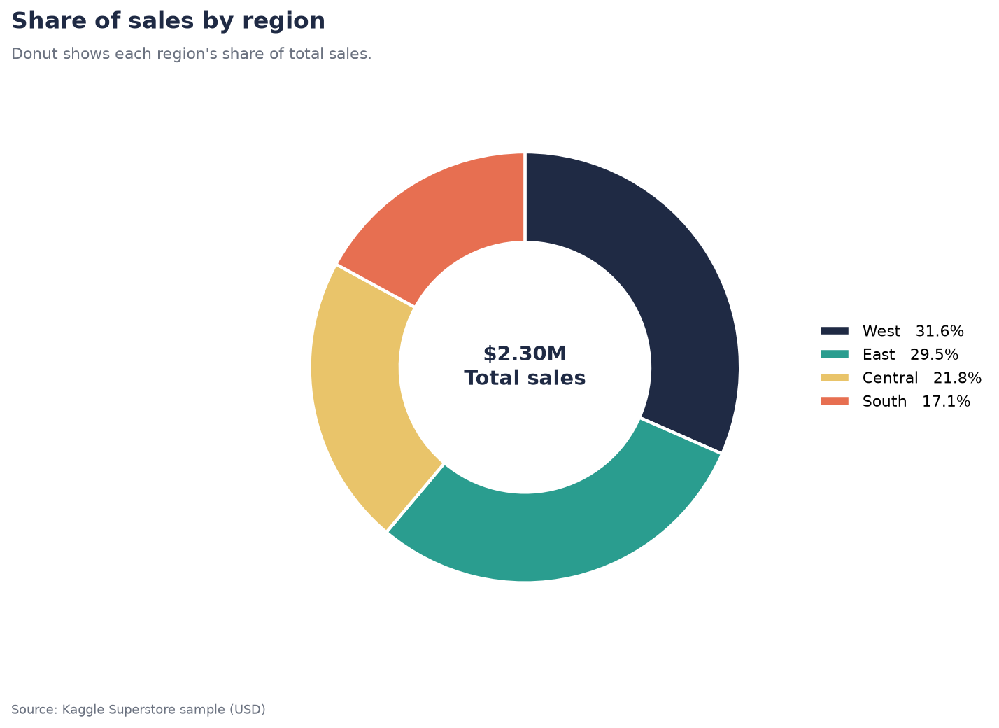

# Sales Data Cleaning + Excel Dashboard



**Turn a messy sales CSV into a clean dataset and a formatted Excel dashboard a
small business owner can actually read.** Built for Moaz's portfolio: a
final-year CS & Data Science student in Alexandria, Egypt, who builds with AI
and must be able to explain every line later.

The workbook opens in Excel with KPI cards, colour-coded tables, conditional
formatting and native charts. No paid services, no API keys, no macros.

## What the data says (real Superstore sample, 2014-2017, USD)

- **Sales $2,297,201** and **profit $286,397** (12.5% margin) across 5,009 orders and 9,994 line items.
- **Technology** is the largest category: $836,154 of sales (36.4%) at 17.4% margin.
- **West** has the best margin (14.9%); **Central** the lowest (7.9%).
- **1,871 line items (18.7%) are loss-making**, totalling -$156,131.
- **Discounts of 40%+** cover 1,139 lines (10.7% of sales) and lose -$125,346.
- **Nov-Dec account for 29.5%** of annual sales (peak: Nov 2017, $118,448).

## What to do next (generated from the data)

1. Cap discounts in **Tables**: it lost $17,725 on $206,966 of sales.
2. Require approval for discounts of 40% or more (1,139 lines lose $125,346).
3. Grow **Technology**: it leads sales at 17.4% margin.

## Dashboard preview





Full workbook: [`output/Sales_Dashboard.xlsx`](output/Sales_Dashboard.xlsx) (open in
Excel). Sheets: **Summary**, **Category**, **Region**, **Monthly_Trend**,
**Top_Products**.

## Dataset

- **Official source:** [Kaggle - Superstore Dataset (vivek468)](https://www.kaggle.com/datasets/vivek468/superstore-dataset-final)
  (Vivek Chowdhury; original data from Tableau's sample, 2014-2017, 9,994 rows, 21 columns).
- **For this run** the real Kaggle file was unavailable without an account, so it
  was downloaded from the public mirror
  `https://gist.githubusercontent.com/mateuszdorobek/98e7882f109bd3fb0763dc4ee1e8e260/raw/Sample%20-%20Superstore.csv`
  (filename `Sample - Superstore.csv`, 2,288,516 bytes, 9,994 rows, 21 columns).
  SHA-256 of the saved `data/raw/superstore.csv`:
  `1D8FB6378C48E005665996F5980E0F0DD4E237B55860EEC34F3AD1CA2CDDFA91`.
  Totals match the published figures: $2,297,200.86 sales / $286,397.02 profit.
  Kaggle remains the official/canonical source.
- **No Kaggle account?** Run `python src/00_generate_sample.py` to create a
  clearly labelled **synthetic** dataset (seed 42, ~1,492 rows, 19 columns).
  Every downstream sheet, chart, PNG and the Excel source badge are labelled
  `SYNTHETIC` so demo data can never be mistaken for a real client's numbers.
- All figures are in **USD** and cover 2014-2017 (a historical sample, not live data).

## Tools (all free)

| Tool | Version | Why |
|---|---|---|
| Python | 3.15.2 | Runtime, tested on 3.15.2; supported range 3.12-3.15 (numpy 2.5.5 requires >=3.12) |
| pandas | 3.1.1 | Loading, cleaning, grouping |
| numpy | 2.5.5 | Synthetic data generation |
| openpyxl | 3.1.5 | Native Excel charts, formatting, KPI cards |
| matplotlib | 3.11.2 | The 3 PNG charts for this README |

## How to run

```powershell
cd C:\Users\Moaz\freelance-portfolio\proj1
python -m venv .venv
.\.venv\Scripts\Activate.ps1          # or use .\.venv\Scripts\python.exe directly
pip install -r requirements.txt
```

**Path A - no Kaggle account (demo):**

```powershell
python src\00_generate_sample.py     # synthetic data
python src\01_check_data.py         # prints "SYNTHETIC dataset"
python src\02_clean.py
python src\03_report.py
```

**Path B - real Kaggle CSV:**

```powershell
# place the file at data\raw\superstore.csv
python src\01_check_data.py         # prints "REAL dataset"
python src\02_clean.py
python src\03_report.py
```

Note: `python src\01_check_data.py` with an empty `data\raw` exits with code 1 and
prints exact download instructions. That is the guard working, not a failure.

If PowerShell blocks activation, use `.\.venv\Scripts\python.exe src\01_check_data.py`
instead. Re-running 02/03 overwrites the outputs cleanly.

## Outputs

```
data/clean/sales_clean.csv      cleaned, typed, derived columns
data/clean/metadata.json       source, counts, flags, totals
output/Sales_Dashboard.xlsx     5 sheets, 6 native charts, KPI cards, formatting
output/01_monthly_sales_profit.png
output/02_subcategory_profit.png
output/03_region_share.png
output/key_findings.md          auto-generated findings
docs/run_synthetic.txt          console transcript (synthetic pass)
docs/run_real.txt               console transcript (real pass)
```

## Cleaning decisions (and why)

- **Duplicates** dropped after trimming whitespace, so ` Consumer ` and `Consumer`
  collapse before comparison. (10 injected in the synthetic demo; 0 in the real file.)
- **Dates** parsed from explicit formats only (`%m/%d/%Y`, ISO, ...). The script
  aborts on an unparseable date instead of guessing day vs month.
- **Critical nulls** (Order ID, Order/Ship Date, Sales, Profit) drop the row;
  optional nulls are filled (name -> `Unknown`, quantity -> 1, discount -> 0) with
  counts printed. Nothing is silent.
- **Invalid rows** dropped with counts: sales <= 0, quantity <= 0, discount outside
  [0, 1], ship date before order date.
- **Money is not rounded** in the data (Sales/Profit keep source precision up to
  4 decimals); rounding happens in Excel/CSV number formats. This keeps totals
  exact.
- **Outliers are flagged, not deleted**: `Flag_Negative_Profit` and
  `Flag_High_Discount` (threshold 40%). A loss is a business signal, not an error.
- **Profit margin** = profit / sales, guarded against zero sales.
- **AOV** = total sales / unique orders (an order can have many line items).
- **Missing months** filled with zero so a gap shows as a dip, not a hidden break.
- Strings are title-cased only on categorical fields (Segment, Region, Category,
  Sub-Category, Ship Mode, Country, State) so IDs and product names keep their case.

## Project structure

```
proj1/
  src/00_generate_sample.py   synthetic data generator (seed 42)
  src/01_check_data.py        input gate + download instructions
  src/02_clean.py             load -> clean -> data/clean/sales_clean.csv
  src/03_report.py            workbook + PNG charts + findings
  data/raw/                   input CSVs (git-ignored)
  data/clean/                 cleaned CSV + metadata.json
  output/                     Sales_Dashboard.xlsx + 3 PNGs + key_findings.md
  docs/                       HOW_TO_REBUILD.md, RUN_OUTPUT.md, run logs
  README.md  LEARNING.md  requirements.txt
```

## Limitations and next steps

- Static snapshot of 2014-2017 sample data, not a live feed.
- Profit is line-level; an order's true profitability needs cost-of-goods data.
- One currency (USD) and one country (US) in the sample.
- Charts are native Excel charts: they recalculate on open but openpyxl does not
  compute formulas, so all values are written as numbers.
- To use a client's export, map their columns to the required schema in
  `src/02_clean.py` (see `COLUMN_ALIASES` note in `docs/HOW_TO_REBUILD.md`).

## About

Built by Moaz - a final-year CS & Data Science student in Alexandria, Egypt.
I build practical data tools for small businesses: clean their messy exports,
turn them into readable dashboards, and explain every number behind them.
See [`LEARNING.md`](LEARNING.md) for a beginner walkthrough of the pipeline and
[`docs/HOW_TO_REBUILD.md`](docs/HOW_TO_REBUILD.md) to rebuild it without AI.
